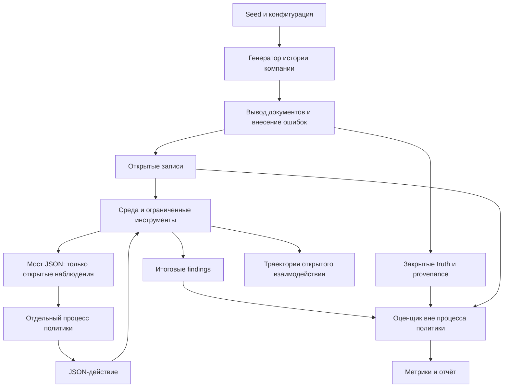

# Архитектура

Статус: v0.1, реализованы публичные модели, деньги, чистая история, две причинные инъекции, хранение, независимые проверки, scorer и development reset/step с инструментами. Поток ниже показывает целевое разделение процессов: OS-изоляция и узкий межпроцессный мост ещё не реализованы. Текущий полный прогон находится в одном процессе и предназначен для разработки.

## Основной поток



Это схема потоков, а не доказательство безопасности. В evaluation награда и диагностика оценщика не передаются политике во время прогона.

## Границы модулей

| Модуль | Ответственность | Ограничения |
| --- | --- | --- |
| `domain` | Записи, выводы, деньги, валюты, временные границы и runtime-валидация | Не зависит от CLI, генератора или политик |
| `generation` | Согласованная история, документы, причинные изменения, эталон | Seed и латентная история не включаются в публичный manifest |
| `environment` | Состояние эпизода, чтение записей, инструменты, бюджеты и завершение | Не возвращает truth, seed, пути или внутренние исключения |
| `evaluation` | Независимая проверка данных, matching, награда, метрики, evaluator-only oracle | Работает вне процесса политики; результаты оценки закрыты до конца прогона |
| `policies` | Random, reconciliation и flag-all через наблюдения | Не импортирует generation/evaluation и не читает файлы эпизода |
| `cli` | Сборка и запуск сценариев | Не содержит предметных правил аудита |
| `contracts` | Общие типы и протоколы обмена | Типизация не заменяет проверку входных JSON |

Предметные модули зависят от `domain` и общего контракта. CLI связывает реализации. Oracle принадлежит `evaluation`, потому что ему нужен привилегированный доступ к эталону.

## Порядок выполнения эпизода

1. Управляющий процесс принимает seed, версию генератора и полную конфигурацию.
2. Генератор создаёт корректную историю, выводит документы, затем вносит записанные изменения.
3. Независимый проверяющий проверяет исходные равенства, расхождения и доступность доказательств.
4. Среда получает открытые записи. Политика получает только начальное наблюдение через мост.
5. Мост принимает ограниченные JSON-действия, среда выдаёт только запрошенный результат.
6. Отправка findings либо лимит завершают эпизод. Оценщик проверяет структурированный ответ.
7. Управляющий процесс сохраняет версию, метрики и траекторию в соответствующие области артефактов.

## Доступ и изоляция

- Отдельные Python-пакеты и отдельный процесс сами по себе не запрещают чтение чужих файлов.
- Целевой запуск политики должен использовать ограничения ОС/контейнера: только разрешённый мост, без сети и без монтирования приватных файлов или каталогов хоста.
- В held-out режиме политике не передаётся объект среды с методом `reset(seed, config)`. Этот API предназначен управляющему процессу.
- Открытые записи доступны политике только через инструменты, даже если сам сервис среды читает файлы напрямую.
- Формат IPC, конкретный механизм ограничения файлов/сети и способ запуска контейнеров ещё предстоит выбрать и проверить на целевом Linux-окружении.
- До проверки этих границ запуск локальной политики считается режимом разработки, а не безопасным held-out запуском.

## Воспроизводимость

Фиксируем seed, config, версии схем и генератора, последовательность действий. В генерации используем локальный источник случайности, а не глобальное состояние. Порядок обхода записей и курсоры определяются явно. Деньги и FX не используют float. Метрики времени записываются отдельно: они не должны менять результат повторного прогона без тайм-аута.

## Хранение

Планируемая структура артефактов:

```text
artifacts/<run_id>/
  public/<episode_id>/   # manifest, policy и доступные записи
  private/<episode_id>/  # truth, provenance, seed/config для воспроизведения
  traces/               # открытые наблюдения и действия
  reports/              # доступные только оценщику результаты
```

Соседство каталогов удобно для разработки и не является изоляцией. В проверочном режиме приватная область недоступна процессу политики; общий родительский каталог не монтируется. Локальные артефакты исключены из Git.

## Интерфейс пользователя

Основной интерфейс — CLI и JSON/JSONL-отчёты. Сайт не нужен для контракта среды. Если позже появится UI, он вызывает те же прикладные сценарии и не переносит правила генерации или оценки в браузер.
